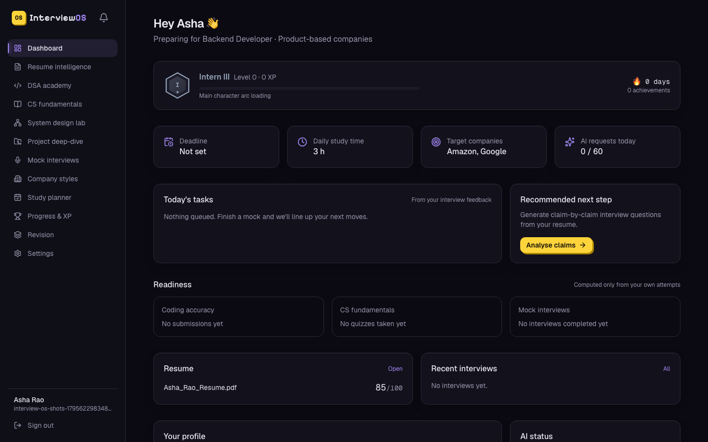
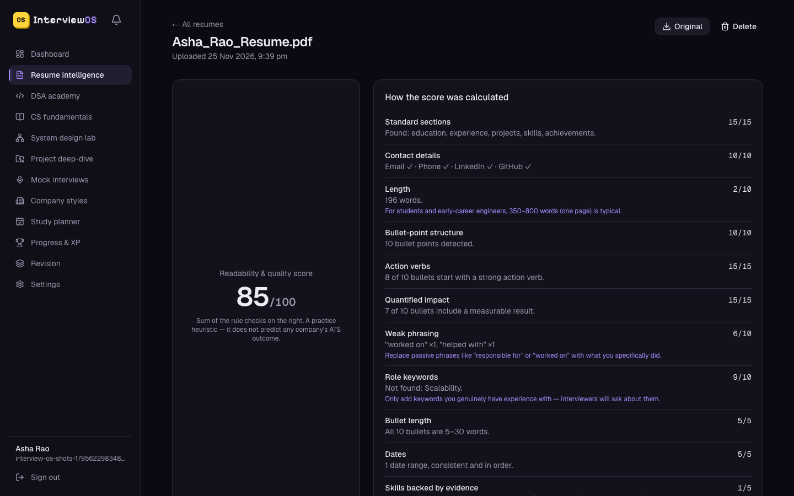
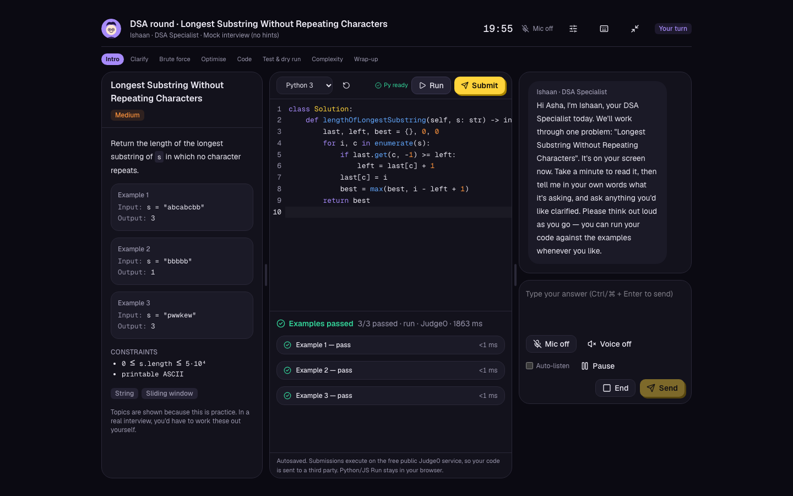
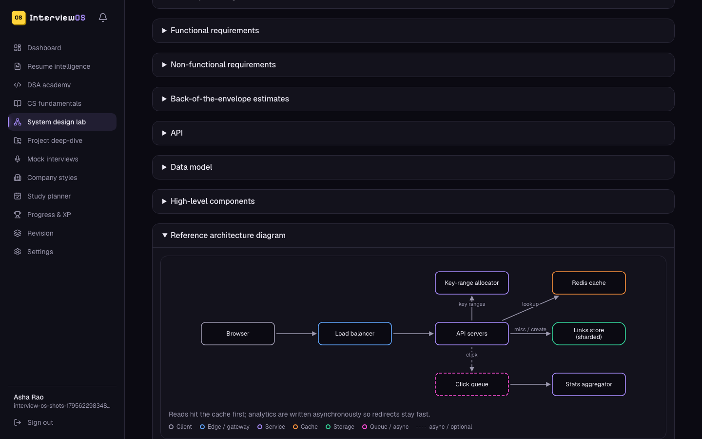

# Interview OS

A free, resume-aware SDE interview-prep platform. Upload your resume, see which claims an interviewer will grill you on, then take adaptive mock interviews (voice or text). Each interview ends with an evidence-based report, and the weaknesses it finds feed back into your daily tasks.

**Live:** https://interview-os-psi.vercel.app · **User guide (PDF):** [docs/Interview-OS-User-Guide.pdf](docs/Interview-OS-User-Guide.pdf) · **Design system:** [/design](https://interview-os-psi.vercel.app/design)



| Resume report | Interview setup |
|---|---|
|  |  |

| DSA live-coding round | System design lab |
|---|---|
|  |  |

## Features

| Module | Status |
|---|---|
| Accounts, onboarding, preparation profile, settings, data deletion | ✅ |
| **Resume intelligence**: PDF/DOCX upload, a 0–100 score where every point is explained, unsupported-skill and missing-keyword detection | ✅ |
| AI resume claims: questions for every claim, risk flags, bullet rewrites (quotes are verified against your resume word for word) | ✅ |
| **Mock interviews**: 9 personas × 10 round types × 5 difficulties, mock vs practice (hints), code panel | ✅ |
| **Live feel**: streamed interviewer replies (speech starts at the first sentence), a 15 s live AI budget, Mumbai region next to the database, proactive check-ins in DSA rounds (never hints in mock mode), a 3-sentence spoken summary the moment you end with the full report built in the background | ✅ |
| **Voice**: Silero VAD (on-device, energy fallback, noisy-room mode) with a cancellable auto-send, barge-in, sentence-streamed speech, on-device natural voice (Kokoro-82M), speech-to-text in the browser, on the device (Whisper via transformers.js) or via Groq when a key is set, per-stage latency, mic check page; text fallback | ✅ |
| **Reports (v2)**: anchored 1–4 rubric, timestamped quotes checked against your transcript, judge-backed correctness for coding, a rule-based verdict (No Hire → Strong Hire) shown step by step, the one thing to fix, 3 drills, measured metrics (reply time, talk share, coding timeline), annotated final code, per-question feedback | ✅ |
| Dashboard: today's tasks from report drills, data-driven next step | ✅ |
| **DSA live-coding round**: problem \| editor \| interviewer, CodeMirror 6 (Python/JS/C++/Java), 206 problems (56 Easy / 110 Medium / 40 Hard, incl. linked lists, trees, tries, union-find, heaps, bit tricks, DP variants) with hidden tests and timed worst-case stress tests, Run in the browser (Pyodide/JS) or on Judge0, Submit on Judge0, code-aware interviewer with a phase machine, graded hints | ✅ |
| Neon-retro design system: themes (Neon / High contrast), Gen-Z / Professional copy toggle, focus mode, keyboard shortcuts | ✅ |
| **Progress & XP**: XP from interviews, solves, tasks and streaks (published formula), levels, 7 tiers × 3 divisions, decay with a tier floor, 18 dated achievements, personal bests, weekly recap, 30-day XP chart, mistake notebook | ✅ |
| **Company styles**: 25 companies (big tech, Indian product, fintech, enterprise, services) — commonly reported loop, focus areas, DSA topics and behavioural themes, labelled "style practice — not actual company questions"; shapes the interviewer and DSA problem choice | ✅ |
| **Interviewers**: 9 original characters with generated avatars and tiers (Warm-up, Standard, Tough, Bar raiser) | ✅ |
| **Next steps**: suggested difficulty from your recent verdicts; Retry / Next harder / Different round; emoji rating; paste detection flagged in reports | ✅ |
| **Notifications** (in-app bell: reports, tasks due, streak at risk, decay, achievements) and an **opt-in public profile** (`/u/handle`, noindex, server-verified stats) | ✅ |
| Resume checks include bullet length (5–30 words) and dates (one format, valid ranges, newest first, Expected for future) | ✅ |
| **DSA academy**: 206 problems with filters and solved status, 13 original pattern guides (when to use, template, pitfalls), one-click practice | ✅ |
| **CS fundamentals**: 100 original questions (OS, DBMS, networks, OOP) graded on the server with options in random order, explanations, accuracy per topic; misses become flashcards | ✅ |
| **Revision**: SM-2 spaced-repetition flashcards from quiz misses, interview reports or your own | ✅ |
| **Study planner**: a week planned from your measured gaps within your daily time, with the reason for each task; add/complete/delete tasks | ✅ |
| **System design lab**: 8 HLD + 4 LLD case studies with reveal-as-you-go reference designs and a reference diagram for each, an on-device sketchpad; practise the same case with the architect interviewer | ✅ |
| **Project deep-dive**: add projects, analyse a public GitHub repo (metadata, README, manifests) into likely questions; practise a focused deep dive | ✅ |

## Tech stack

- **Next.js 16** (App Router, Server Actions, `proxy.ts`), React 19, TypeScript (strict), Tailwind CSS 4
- **Supabase**: Postgres with Row Level Security on every table, Auth, private Storage
- **AI**: provider-agnostic adapter over OpenAI-compatible APIs. Fallback chain: Gemini (free tier) → Groq → OpenRouter `:free` models → Ollama. It never routes to a paid model.
- **Code execution**: Pyodide + Web Workers in the browser; [Judge0](https://judge0.com) (public CE by default, self-hostable) on the server
- **Voice**: Web Speech API, Silero VAD (`@ricky0123/vad-web`) with an energy-VAD fallback, Kokoro-82M TTS and Whisper STT on the device (transformers.js), optional Whisper via Groq
- **zod** validation on every action/route and on every AI response
- **Vitest** unit tests, **Playwright** end-to-end tests on a deterministic mock AI (no quota used), GitHub Actions CI, gitleaks secret scan
- Hosted on **Vercel** (Hobby, `bom1`) next to Supabase (`ap-south-1`); enforced nonce-based CSP; a GitHub Action keeps the free database awake

## Repository layout

```
src/
  proxy.ts                  session refresh + route guard
  app/(auth)/               login, signup, password reset
  app/(app)/                authenticated app: dashboard, resume, interview, dsa, fundamentals, revision,
                            planner, system-design, projects, companies, progress, mic-check, settings
  app/u/[handle]/           opt-in public profile (security-definer RPC)
  app/api/                  health, interview turn (SSE)/run/events/summary/complete, voice STT, notifications, CSP reports
  app/actions/              server actions (zod-validated)
  components/               UI primitives, shell (nav, bell), resume, interview (room, avatars), dsa, voice, progress, learn
  lib/ai/                   provider chain, JSON/injection guards, per-user quota
  lib/resume/               PDF/DOCX extraction, deterministic resume rules (incl. bullet length, dates)
  lib/interview/            prompts, anchored rubric, verdict, metrics, suggestions, company styles
  lib/progress/             XP, levels, tiers, achievements, bests
  lib/voice/                VAD, sentence chunking for TTS
  lib/learn/                fundamentals bank, SM-2, weekly planner, design cases
  lib/projects/             GitHub repo snapshot and analysis
  lib/interview/            personas, rubrics, interviewer engine, evaluator, transcript analysis
  lib/services/             AI resume analysis
  lib/dsa/                  problem bank, harnesses, graders, Judge0 + browser runners, phase machine
supabase/migrations/        schema, RLS, storage policies (apply in order)
tests/                      Vitest unit tests
e2e/                        Playwright tests (+ a real-PDF generator)
docs/                       architecture, database, API, security, testing, deployment
```

## Run locally

Requirements: Node 20+ and a free Supabase project. You also need at least one free AI key, from Gemini, Groq or OpenRouter.

```bash
npm install
cp .env.example .env.local        # fill in your own values
# Apply supabase/migrations/*.sql in order (Supabase SQL editor or `supabase db push`)
npm run dev                       # http://localhost:3000
```

| Script | What it does |
|---|---|
| `npm run dev` / `build` / `start` | Next.js |
| `npm test` | Vitest unit tests |
| `npm run typecheck` / `lint` | `tsc --noEmit` / ESLint |
| `npm run test:e2e` | Playwright against a local production build with mock AI (`AI_MOCK=1`); uses your `.env.local` Supabase |

Deployment details: [docs/DEPLOYMENT.md](docs/DEPLOYMENT.md).

## Principles

- **No fabricated numbers.** Metrics stay empty until you have real attempts. AI-cited evidence is verified against your own text, and evidence that doesn't match is discarded.
- **AI is optional.** Resume rules, saved reports and progress all work when AI providers are down. Failures show an honest message and never a fake answer.
- **Privacy.** Resumes are stored privately, and AI processing only happens after you give consent. No audio is stored. You can delete your account and all your data.

## Docs

[Architecture](docs/ARCHITECTURE.md) · [Database](docs/DATABASE.md) · [API](docs/API.md) · [Security](docs/SECURITY.md) · [Testing](docs/TESTING.md) · [Deployment](docs/DEPLOYMENT.md) · [Changelog](docs/CHANGELOG.md) · [Roadmap](docs/TODO.md)
