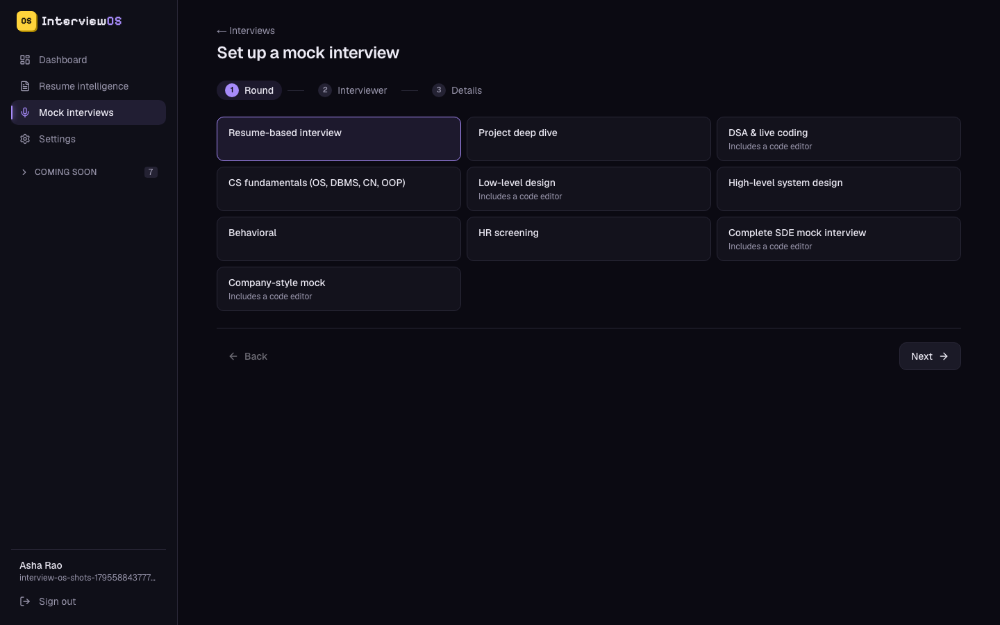

# Interview OS

A free, resume-aware SDE interview-prep platform. Upload your resume, see which claims an interviewer will grill you on, then take adaptive mock interviews (voice or text). Each interview ends with an evidence-based report, and the weaknesses it finds feed back into your daily tasks.

**Live:** https://interview-os-psi.vercel.app · **User guide (PDF):** [docs/Interview-OS-User-Guide.pdf](docs/Interview-OS-User-Guide.pdf) · **Design system:** [/design](https://interview-os-psi.vercel.app/design)


| Resume report | Interview setup |
|---|---|
|  |  |


## Features

| Module | Status |
|---|---|
| Accounts, onboarding, preparation profile, settings, data deletion | ✅ |
| **Resume intelligence**: PDF/DOCX upload, a 0–100 score where every point is explained, unsupported-skill and missing-keyword detection | ✅ |
| AI resume claims: questions for every claim, risk flags, bullet rewrites (quotes are verified against your resume word for word) | ✅ |
| **Mock interviews**: 9 personas × 10 round types × 5 difficulties, mock vs practice (hints), code panel | ✅ |
| **Voice v2**: pause detection (on-device VAD) with a cancellable auto-send, barge-in, sentence-streamed speech, optional on-device natural voice (Kokoro-82M), optional Whisper via Groq when a key is set, per-stage latency, mic check page; text fallback | ✅ |
| **Reports (v2)**: anchored 1–4 rubric, timestamped quotes checked against your transcript, judge-backed correctness for coding, a rule-based verdict (No Hire → Strong Hire) shown step by step, the one thing to fix, 3 drills, measured metrics (reply time, talk share, coding timeline), annotated final code, per-question feedback | ✅ |
| Dashboard: today's tasks from report drills, data-driven next step | ✅ |
| **DSA live-coding round**: problem \| editor \| interviewer, CodeMirror 6 (Python/JS/C++/Java), 79 problems (incl. linked lists and trees) with hidden tests and timed worst-case stress tests, Run in the browser (Pyodide/JS) or on Judge0, Submit on Judge0, code-aware interviewer with a phase machine, graded hints | ✅ |
| Neon-retro design system: themes (Neon / High contrast), Gen-Z / Professional copy toggle, focus mode, keyboard shortcuts | ✅ |
| **Progress & XP**: XP from interviews, solves, tasks and streaks (published formula), levels, 7 tiers × 3 divisions, decay with a tier floor, 18 dated achievements, personal bests, weekly recap, 30-day XP chart, mistake notebook | ✅ |
| CS fundamentals academy, system design lab | 🚧 planned |

## Tech stack

- **Next.js 16** (App Router, Server Actions, `proxy.ts`), React 19, TypeScript (strict), Tailwind CSS 4
- **Supabase**: Postgres with Row Level Security on every table, Auth, private Storage
- **AI**: provider-agnostic adapter over OpenAI-compatible APIs. Fallback chain: Gemini (free tier) → Groq → OpenRouter `:free` models → Ollama. It never routes to a paid model.
- **Code execution**: Pyodide + Web Workers in the browser; [Judge0](https://judge0.com) (public CE by default, self-hostable) on the server
- **zod** validation on every action/route and on every AI response
- **Vitest** unit tests, **Playwright** end-to-end tests on a deterministic mock AI (no quota used), GitHub Actions CI, gitleaks secret scan
- Hosted on **Vercel** (Hobby)

## Repository layout

```
src/
  proxy.ts                  session refresh + route guard
  app/(auth)/               login, signup, password reset
  app/(app)/                authenticated app: dashboard, resume, interview, settings
  app/api/                  health check, interview turn/complete routes
  app/actions/              server actions (zod-validated)
  components/               UI primitives, shell, resume, interview (voice hooks, room)
  lib/ai/                   provider chain, JSON/injection guards, per-user quota
  lib/resume/               PDF/DOCX extraction, deterministic resume rules
  lib/interview/            personas, rubrics, interviewer engine, evaluator, transcript analysis
  lib/services/             AI resume analysis
  lib/dsa/                  problem bank, harnesses, graders, Judge0 + browser runners, phase machine
supabase/migrations/        schema, RLS, storage policies (apply in order)
tests/                      Vitest unit tests
e2e/                        Playwright tests (+ a real-PDF generator)
docs/                       architecture, database, API, security, testing, deployment
```

## Run locally

Requirements: Node 20+ and a free Supabase project. You also need at least one free AI key, from Gemini, Groq or OpenRouter.

```bash
npm install
cp .env.example .env.local        # fill in your own values
# Apply supabase/migrations/*.sql in order (Supabase SQL editor or `supabase db push`)
npm run dev                       # http://localhost:3000
```

| Script | What it does |
|---|---|
| `npm run dev` / `build` / `start` | Next.js |
| `npm test` | Vitest unit tests |
| `npm run typecheck` / `lint` | `tsc --noEmit` / ESLint |
| `npm run test:e2e` | Playwright against a local production build with mock AI (`AI_MOCK=1`); uses your `.env.local` Supabase |

Deployment details: [docs/DEPLOYMENT.md](docs/DEPLOYMENT.md).

## Principles

- **No fabricated numbers.** Metrics stay empty until you have real attempts. AI-cited evidence is verified against your own text, and evidence that doesn't match is discarded.
- **AI is optional.** Resume rules, saved reports and progress all work when AI providers are down. Failures show an honest message and never a fake answer.
- **Privacy.** Resumes are stored privately, and AI processing only happens after you give consent. No audio is stored. You can delete your account and all your data.

## Docs

[Architecture](docs/ARCHITECTURE.md) · [Database](docs/DATABASE.md) · [API](docs/API.md) · [Security](docs/SECURITY.md) · [Testing](docs/TESTING.md) · [Deployment](docs/DEPLOYMENT.md) · [Changelog](docs/CHANGELOG.md) · [Roadmap](docs/TODO.md)
