# Redesign: before / after

Direction: "neon-retro, but grown-up" — 80% calm dev tool, 20% neon flavour (hero, wordmark, primary CTA, focus glow).
Design system: [/design](https://interview-os-psi.vercel.app/design) · tokens in `src/app/globals.css` · WCAG AA enforced by `tests/design-tokens.test.ts`.

| Page | Before | After |
|---|---|---|
| Landing | 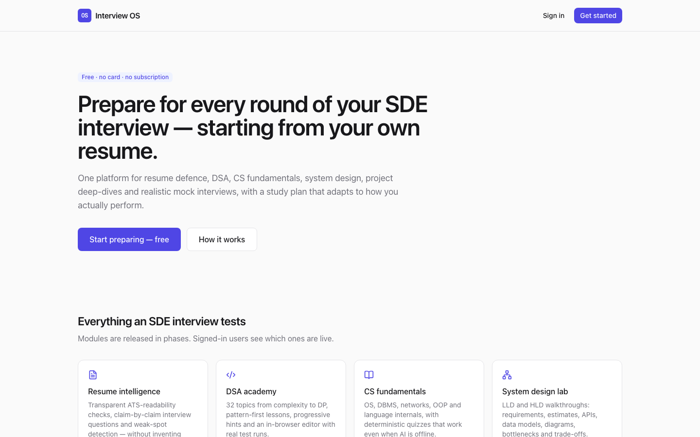 | 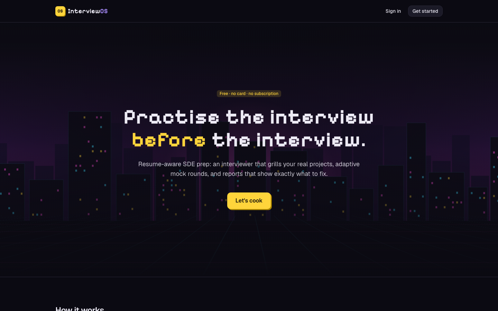 |
| Landing (mobile) | 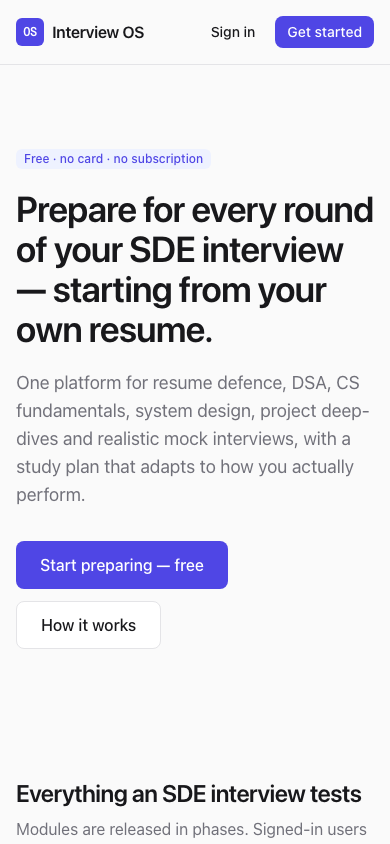 | 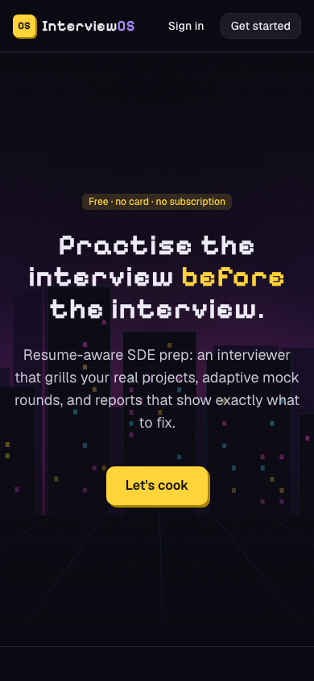 |
| Dashboard | 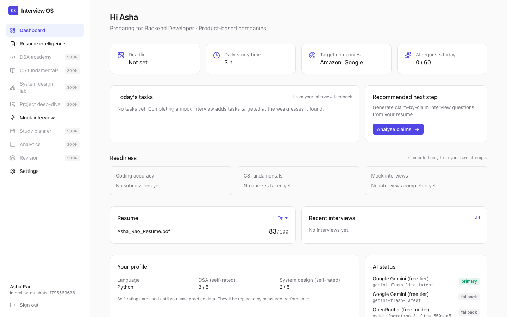 | 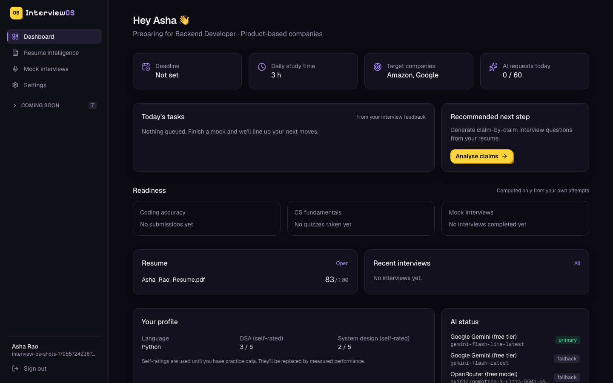 |
| Dashboard (mobile) | 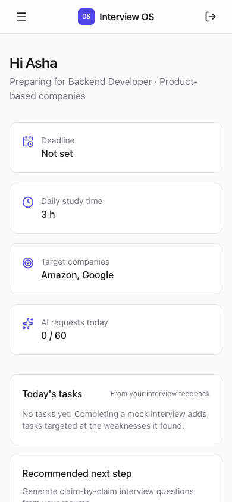 | 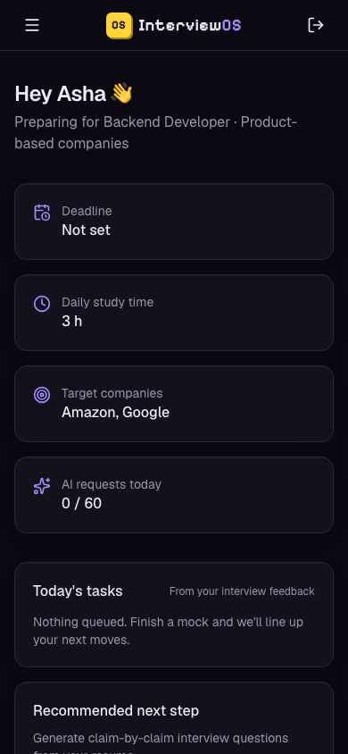 |
| Interview setup | 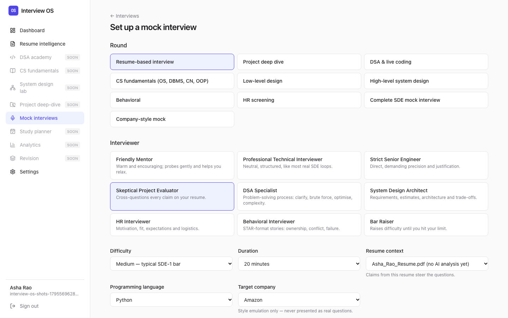 | 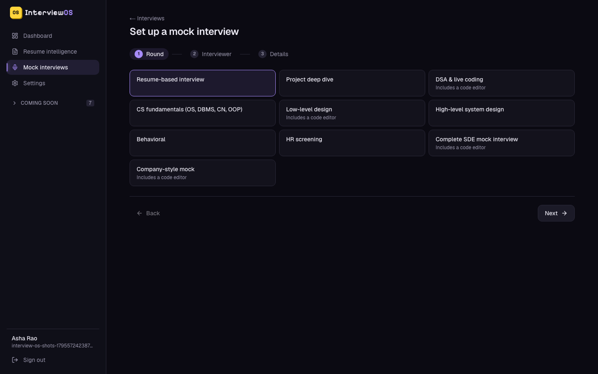 |
| Interview setup (mobile) | 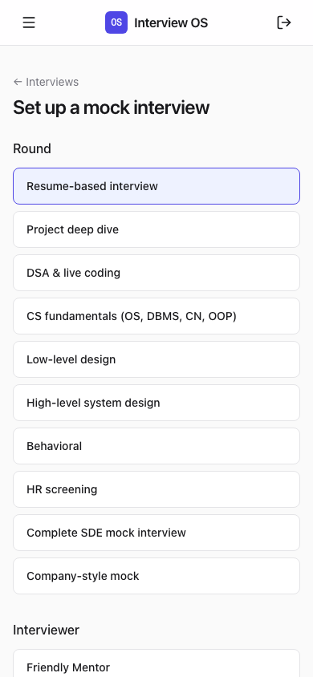 | 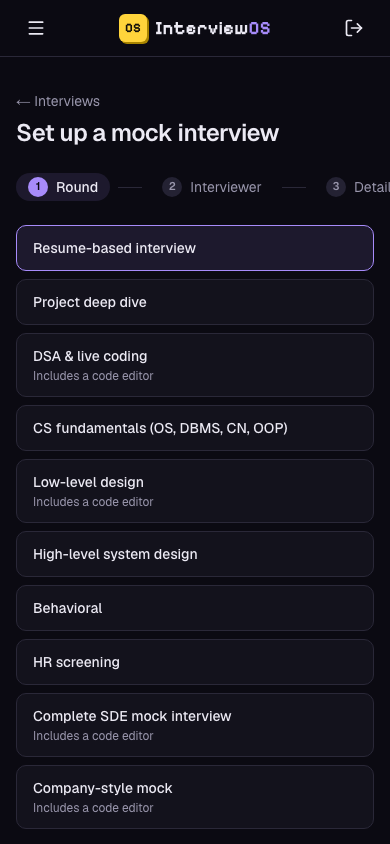 |
| Resume report | 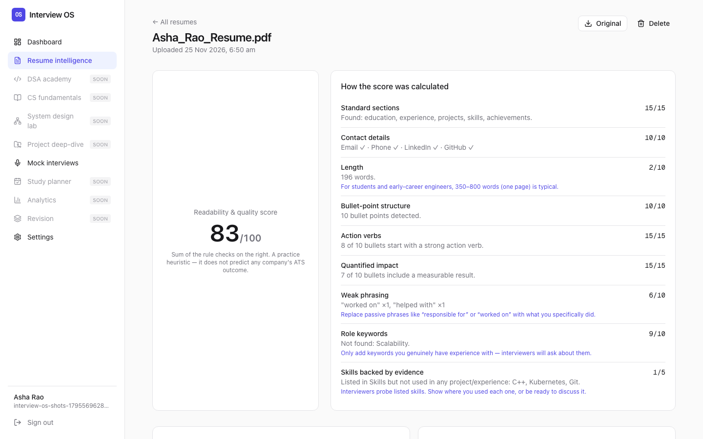 | 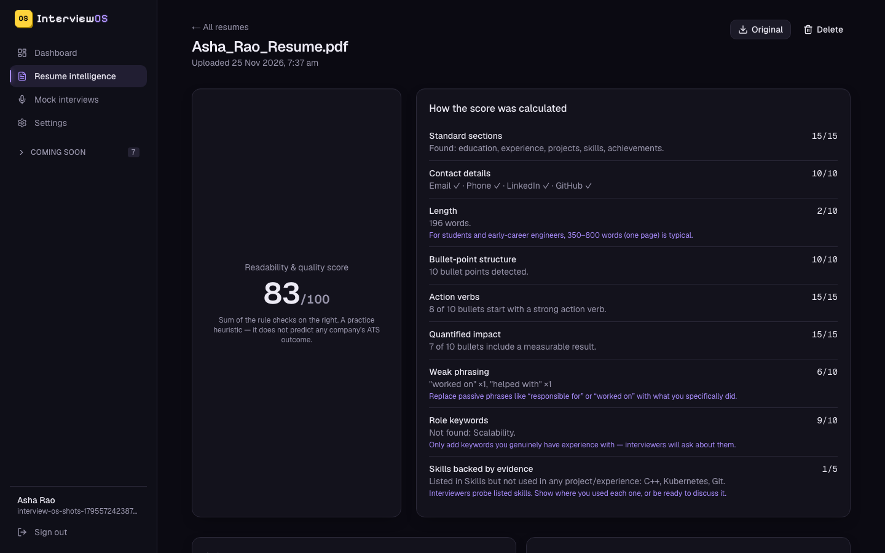 |
| Resume report (mobile) | 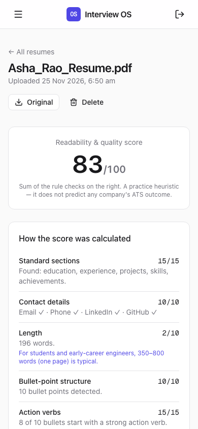 | 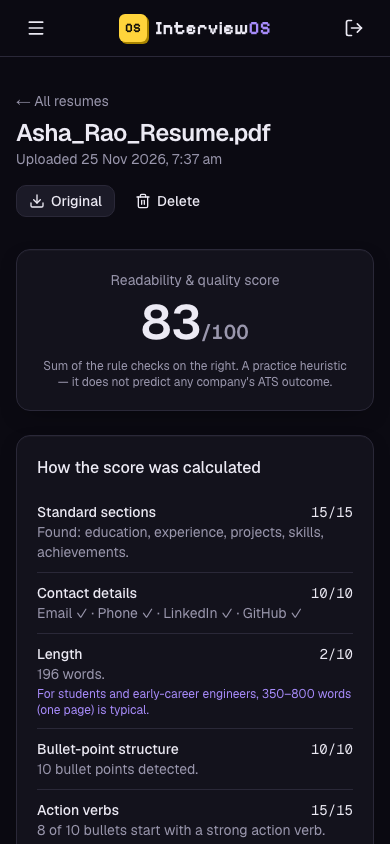 |

Regenerate: `E2E_AI_MOCK=0 SHOTS_DIR=docs/redesign/after npx playwright test e2e/screenshots.spec.ts`
